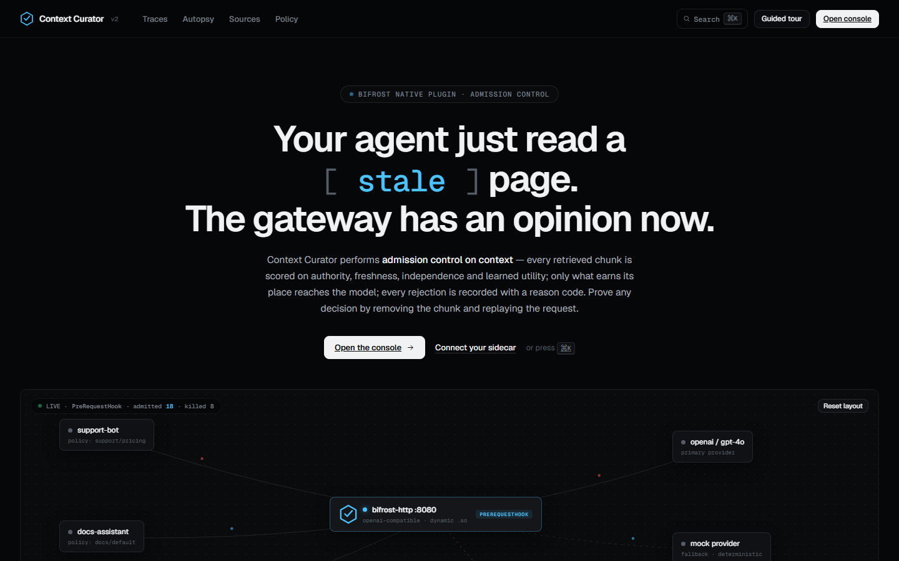
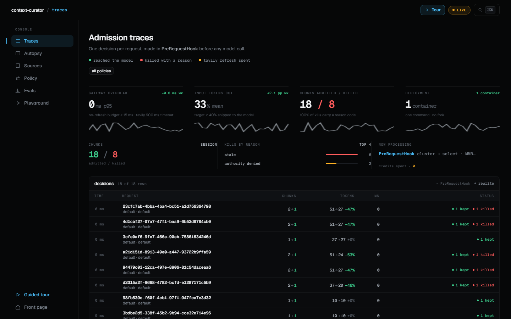
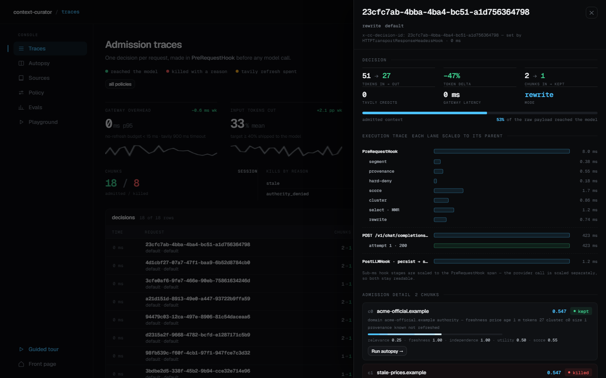
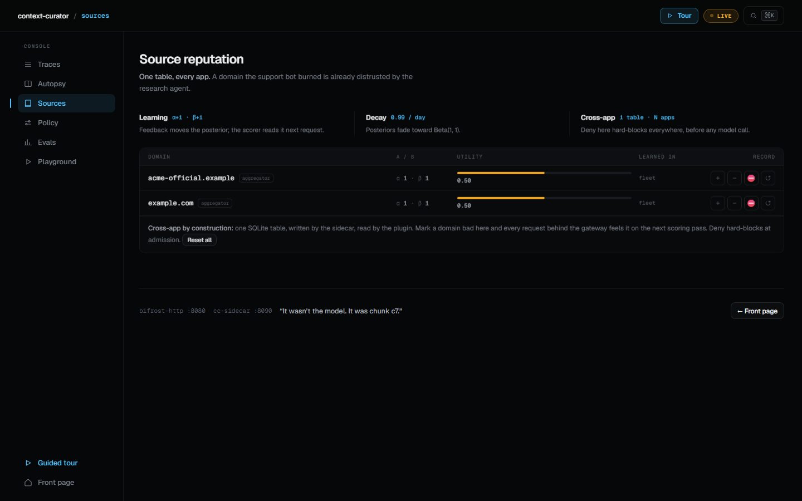
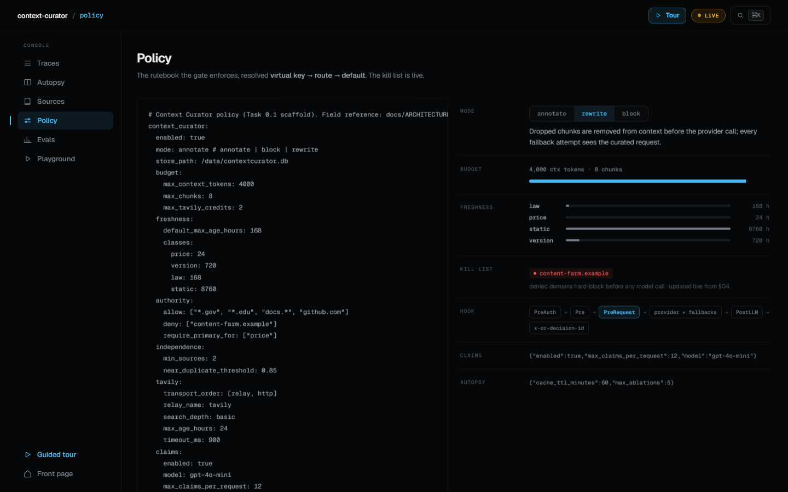
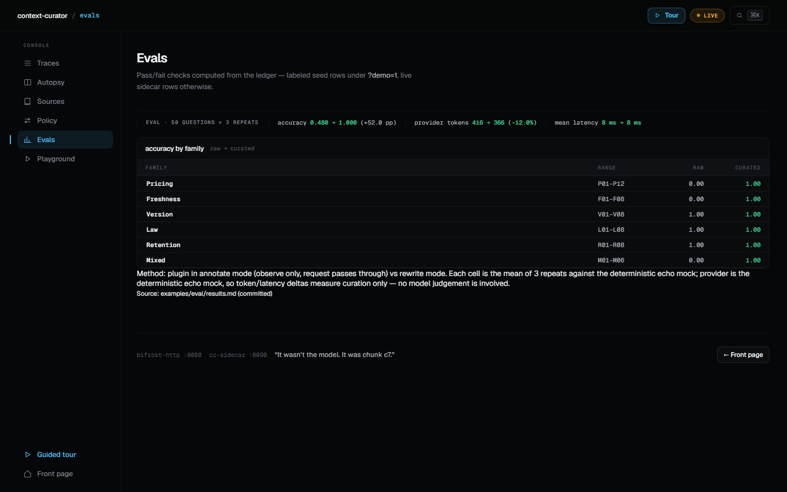

# Context Curator

**A native Bifrost gateway plugin (Go `.so`) that decides which sources are allowed to speak to your model.**

> This is an entry for the **BIFEST challenge: open-source Bifrost gateway extension (Go `.so` plugin)** — it fits that track exactly. Tavily-powered refresh inside counts toward **both** technologies, so the submitter should tick the **Tavily-integration checkbox** at submission time.

---

## Problem

Every agent in the company walks through one door to reach a model: the Bifrost gateway. One evening a customer gets quoted a wrong, stale price — $39 instead of $49. The post-mortem asks one question: **who told the bot that?**

The gateway forwarded everything without checking IDs: a current pricing page, a stale blog post, a poisoned content-farm deal. No reranker, compressor, or RAG filter enforces one source policy for every app behind the door — and when the answer is wrong, nothing can say which chunk caused it.

## Solution

Context Curator is the bouncer **standing IN that door**: a native `.so` plugin running in the gateway's own request path (`PreRequestHook`), scoring every retrieved chunk (authority, freshness, independence, learned Beta reputation), killing losers with reason codes, and writing one receipt per decision into SQLite — provable by replay (Autopsy). **One door, one policy, one receipt per request — for every app at once.** There are no per-app policies; the gateway enforces a single fleet-wide rule.

## Tech stack

| Layer | Technology |
|---|---|
| Gateway plugin | Go, `-buildmode=plugin` (`.so`, `PreRequestHook` / `PostLLMHook`), Bifrost |
| Gateway | Bifrost `:8080`, OpenAI-compatible (`/v1/chat/completions`) |
| Console | Next.js 16 (`web/`, `next@16.4.5`) on `:3000`, proxies same-origin `/api/cc/*` to the sidecar |
| Sidecar | Go (`sidecar/`) on `:8090` — read-only console API, autopsy replay, reputation |
| Freshness evidence | Tavily refresh via Bifrost relay (`/relay/tavily/search`) → direct HTTP fallback, per-request credit budget |
| Demo provider | Deterministic echo mock (`mock/mock-model`) — repeats admitted context only |
| Storage | One SQLite file (`/data/contextcurator.db`, `cc-data` volume) |

## Architecture

```
apps (support-bot, docs-assistant, research-agent)
  │
  ▼
Bifrost :8080 ── plugin PreRequestHook ──► mock / primary provider
  │   segment → provenance → score → refresh → select → rewrite
  │   decisions
  ▼
cc-sidecar :8090 (read-only console API + autopsy replay)
  │
SQLite — one file (/data/contextcurator.db)
```

The plugin runs **once per request, in-process**, before the provider call; mutations commit and survive fallbacks. The sidecar exists because a `.so` plugin cannot register HTTP routes — it serves the console API and autopsy, sharing the one SQLite file. Details: [docs/ARCHITECTURE.md](docs/ARCHITECTURE.md).

## Measured results

50 trap questions × 3 repeats, raw (plugin `annotate`, pass-through) vs curated (`rewrite`), deterministic echo mock. Accuracy is 1 per question iff the echoed answer contains every `must_contain` token and none of the `must_not_contain` tokens. Full table: [examples/eval/results.md](examples/eval/results.md).

| | raw | curated |
|---|---|---|
| mean accuracy | 0.480 | **1.000** (+52pp on this trap set) |
| mean provider tokens | 416 | **366 (−12.0%)** |
| mean latency | 8 ms | 8 ms (unchanged — no latency cost, not a win) |

Echo-mock caveat: the provider only repeats admitted context — token/latency deltas measure curation alone; no model judgement is involved, and accuracy is a trap-set score, not a general benchmark.

Traps covered: stale prices (`$39` refused, `$49` kept), denied domains, near-duplicate press releases (collapsed to one chunk), version/law controls.

## Screenshots

Live console (`http://localhost:3000`), six beats of the demo:













## Quickstart

One container, one command:

```bash
docker compose up -d --build
```

Seed one decision (mock provider, deterministic echo) — copy verbatim from [docs/demo/video-script.md](docs/demo/video-script.md):

```bash
curl http://localhost:8080/v1/chat/completions \
  -H "Content-Type: application/json" \
  -d '{
    "model": "mock/mock-model",
    "temperature": 0.0,
    "messages": [
      {"role": "user", "content": "How much is Pro?"},
      {"role": "tool", "content": "Pro is $49/seat/month. Source: https://example.com/pricing (fetched 2026-11-03)"},
      {"role": "tool", "content": "Pro is $39/seat/month. Source: https://stale-blog.example/post (fetched 2024-02-01)"},
      {"role": "tool", "content": "Pro dealz!!! Source: https://content-farm.example/deals (fetched 2026-11-03)"}
    ]
  }'
```

Expected: the answer echoes `$49`; `$39` drops as `stale`, content-farm drops as `authority_denied`.

Then open **http://localhost:3000** — Traces shows the new row; click it for the drawer, Autopsy, Sources, Policy. Ports: `:8080` gateway, `:8090` sidecar API, `:3000` console. Full operations guide: [docs/SETUP.md](docs/SETUP.md). Deploy target: [render.yaml](render.yaml). Compose file: [docker-compose.yml](docker-compose.yml).

## Configuration

| Variable | Default | Purpose |
|---|---|---|
| `CC_ADMIN_TOKEN` | `dev-token` | Bearer for sidecar admin routes; injected server-side by Next proxy, never reaches the browser |
| `CC_SIDECAR_URL` | `http://127.0.0.1:8090` | Where the Next server proxy forwards `/api/cc/*` |
| `OPENAI_API_KEY` | `unused` | Live models; `unused` keeps the deterministic mock only |
| `MOCK_API_KEY` | `unused` | Mock provider credential |
| `TAVILY_API_KEY` | `unused` | Live freshness evidence; unset degrades refresh to `refresh_failed`, never blocks |
| `BIFROST_SETUP_TOKEN` | `dev-setup-token` | One-time gateway config bootstrap (`X-Bifrost-Setup-Token`) |
| `PORT` | `3000` | Next console port |

Policy itself lives in the plugin `config` block (`config/` → `/data/bifrost/config.json`); schema in [docs/ARCHITECTURE.md](docs/ARCHITECTURE.md) §8. Modes: `annotate` (record, change nothing — safe default) · `rewrite` (drop inadmissible) · `block` (reject on hard deny).

## Project map

| Path | Contents |
|---|---|
| `plugin/` | The `.so` — segment, provenance, score, refresh, cluster, select, rewrite, record |
| `sidecar/` | `:8090` API — decisions, autopsy replay, reputation, claims |
| `web/` | Next.js 16 console (`web/package.json`) on `:3000` |
| `examples/eval/` | 50-question harness + [results.md](examples/eval/results.md) |
| `config/` | Gateway + policy seed config |
| `docs/demo/` | [video-script.md](docs/demo/video-script.md) (numbers + DO-NOT-SAY list), shots, storyboard |

## Honesty / disclosures

- **Echo mock.** All demo answers and all eval numbers come from `mock/mock-model`, a deterministic echo — it repeats admitted context; it does not evaluate trust or resemble a frontier model.
- **Semantics are frozen by spec.** Pure-removal influence is **0 by spec** (removing nothing changes nothing); attribution names removals, and Autopsy proves kept-chunk influence by replay with/without.
- **Legacy DB rows lack chunks.** Decisions written before chunk persistence show counts without per-chunk rows; new decisions carry the full decision file.
- What this does **not** claim: no frontier-model results, no latency win (8 ms → 8 ms), no savings beyond the measured 12.0%, no security guarantees (it enforces one gateway source policy with a reason code per drop — not a block on all injection), no per-app policies.

## Submission pointers

- **Track:** Bifrost-primary (native `.so` gateway extension); also tick the **Tavily-integration checkbox** (relay → HTTP refresh is inside this repo).
- **Requires:** public repo + PPT link + ≤ 3 min demo video. Deadline **Nov 15, 23:59 IST**.
- **TODO (owner: submitter):** `PPT: <link>` — record the video per [docs/demo/video-script.md](docs/demo/video-script.md) and obey its DO-NOT-SAY list; `VIDEO: <link>`; make the repo public (`github.com/athmabhiram/context-curator`).

---

Compression asks how few tokens. We ask which sources are allowed to speak.
